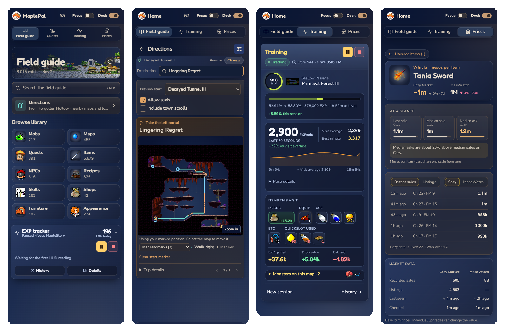
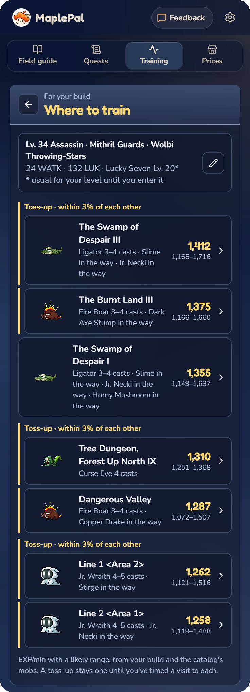
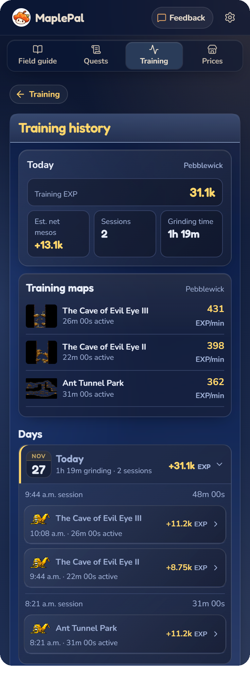
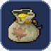
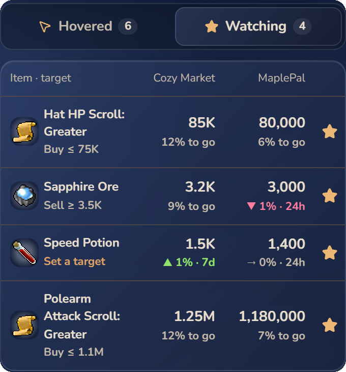

# MaplePal Field Guide

**A glass companion window that docks beside MapleStory.** 
Look anything up, get directions from where you stand, follow your quests, find where to train and see what your training is really earning, without alt-tabbing to a wiki.

🔒 **Every download ships a SHA-256 checksum and a signed GitHub build attestation** you can verify, and a separate window that never touches the game. <a href="#is-it-safe">Is it safe? →</a>

🧪 **This is a beta.** The Field Guide is new and changes often, so some things may not work yet or may break after a game patch. If something looks off, <a href="https://github.com/gagandeepgill/maple-pal-public/issues/new/choose">let us know</a>. Every report helps.

  

## What it does

###  Field guide
Search one catalog of mobs, maps, quests, items, NPCs, recipes, skills, shops, furniture and appearances. Press <kbd>Ctrl</kbd> <kbd>K</kbd> to search, then open a record to see its stats, drops, spawn maps and where to find it. Item pages also show the NPC sell price and which shops sell scarce potions. Everything is on your PC, so results show up as you type, and the library refreshes itself after a game patch.

###  Directions from where you stand
Pick a destination, or one of the main towns and your recent trips, and the guide reads your minimap to find out where you are. It then draws the route on the real map art: which portal to take, when to climb, and when a taxi or town scroll is quicker. If your minimap is minimised or covered, it tells you so.

###  Quest guide

Each quest is laid out as **Accept → Collect → Turn in**, with the map, the monster and how far away it is. The guide reads your quest log and Etc inventory to know which step you're on. When you accept a quest at an NPC, its guide opens by itself, with a small **Quest accepted** notice and an **Undo** if you'd rather stay where you were. The Quests tab updates live while your quest window is open.

 

###  Training tracker
Start tracking and the widget reads your EXP bar: EXP per minute, your best minute, time to next level, and how this visit compares with your average. It also counts mesos and drops, the potions you used and their cost, and your kills (yours and your party's), and shows your net profit. It starts by itself once you're hunting, and reminds you when your inventory is full. Every visit is saved to **History**, grouped by day with that day's EXP.

**Where to train** suggests maps for your level and shows your own measured pace on maps you've trained on. Save your build (**I'm wearing this** on an equip's page fills it in). Thieves using Lucky Seven also get the maps ranked by estimated EXP per minute for that build, and more classes are on the way.

&nbsp;&nbsp;

###  Prices

Hover over an item in MapleStory and its MaplePal price shows up in the widget, with how it moved in the last day, recent sales and listings by channel, and how many recorded sales that price is based on. Star an item to watch it, set a target, and the Prices tab tells you when it's reached.

 

###  Made to sit beside the game
- **Dock** snaps it to the edge of the screen. When the game is full screen, it docks on your second monitor. **Focus** brings it forward when you return to the game, and MapleStory keeps your keyboard.
- **Open with MapleStory** starts the widget when the game comes to the front.
- Updates install in the background without a window over the game, and **What's new** lists what changed in each one.
- It reads only what the game already shows on screen and its installed files. It never changes the game or its files.

## Install

1. **[Download `MaplePal-Field-Guide-setup.exe`](https://github.com/gagandeepgill/maple-pal-public/releases/latest/download/MaplePal-Field-Guide-setup.exe)** and run it. It installs for your Windows user only, with no admin prompt, and adds a Start menu entry.
2. If Windows says **"Windows protected your PC"**, click **More info**, then **Run anyway**. This shows up because the installer isn't code-signed yet.
3. Open **MaplePal Field Guide** from the Start menu. The installer carries the whole library, so it sets itself up on the first start with nothing to download, even offline.
4. Play at any **UI Size**. The screen readers work with all of them, so keep the one you like.
5. If the widget can't find MapleStory on the first start, it asks you to choose `MapleStory.exe`. Steam installs work too. You can change it later in **Settings** (the gear) **→ Open with MapleStory → Change**.

**Requirements:** 64-bit Windows 11, or Windows 10 version 2004 or later. If the PC doesn't have Microsoft Edge WebView2, the installer downloads it.

The release page also lists `MaplePal-Field-Guide-update.exe`. That's the smaller file the widget uses to update itself, without the library, so always install from `setup.exe`.

## Is it safe?

<table>
<tr><th>✅ What it does</th><th>🚫 What it never does</th></tr>
<tr><td valign="top">
<ul>
<li>Captures the MapleStory window, the way OBS or a screenshot tool does, to read the minimap, EXP bar and the item you hover over</li>
<li>Reads the game's installed files for maps, quests and items</li>
<li>Connects to GitHub for updates and new game data, to a market site for the prices of items you hover, and to a data server for shared prices (and for the library, if GitHub can't be reached)</li>
<li>Saves its data in your own user folder</li>
</ul>
</td><td valign="top">
<ul>
<li>Draw on top of the game or hook into it — it's a separate window you dock beside MapleStory, <b>not an overlay</b></li>
<li>Read or change the game's memory, or inject anything into the game</li>
<li>Press keys or click for you (no botting or macros)</li>
<li>Ask for your Nexon or MapleStory login</li>
<li>Send your quests, Training history or settings anywhere</li>
</ul>
</td></tr>
</table>

**Check the download yourself**

- **Scan it:** upload the installer to [VirusTotal](https://www.virustotal.com), which runs it past about 70 antivirus engines. When a release's notes include a VirusTotal link, that scan was made by the same workflow that built the file.
- **Compare the checksum:** each release lists the installer's SHA-256 in its notes and in `SHA256SUMS.txt`. In PowerShell, run `Get-FileHash .\MaplePal-Field-Guide-setup.exe`. The hash should match exactly.
- **See where it was built:** every installer is built by this repository's public [Actions workflow](.github/workflows/release.yml), and the [build logs](https://github.com/gagandeepgill/maple-pal-public/actions) are public. Each build has a signed GitHub attestation. With the GitHub CLI, `gh attestation verify MaplePal-Field-Guide-setup.exe --repo gagandeepgill/maple-pal-public` confirms the file came from that workflow and wasn't changed after.
- **Updates are signed:** the widget installs an update only if it carries the release signature, so a tampered download is refused.

**Why does Windows warn about it?** SmartScreen shows "Windows protected your PC" for any new app that hasn't been code-signed and downloaded by many people yet. It isn't a virus detection. Click **More info**, then **Run anyway**.

## FAQ

<b>Something isn't working. How do I report it?</b>

Thanks for trying the beta! [Open a report](https://github.com/gagandeepgill/maple-pal-public/issues/new/choose) and say what you were doing, what you expected and what happened instead. Add the version from the bottom of the widget and a screenshot if you can. Please don't include your Nexon login or anything else private.

<b>How does it update?</b>

It checks for a new version every 30 minutes and downloads it in the background. The update installs when you click the update button in the footer, when you close the widget, or during a break when nothing is being tracked. Most updates switch over without the widget closing, and none show a window over the game. **What's new** lists the changes afterwards. Every update is checked against a signature before it installs. After a game patch, the library updates itself too.

<b>Is my data uploaded anywhere?</b>

No. Your quest progress, Training history and settings stay on your PC in `%LOCALAPPDATA%\MaplePal\FieldGuide`. Updates and reinstalls never touch them. This repository holds only the installer and its update files. It has no source code and no player data.

<b>Does it work for any character or server?</b>

Yes. Nothing is tied to one character or account. Quest and Training progress builds up from whichever character you're playing on that PC.

<b>Does it work on Mac?</b>

Not directly. It's a Windows app, so on a Mac it needs a Windows virtual machine that can also run MapleStory.

<b>The Training tracker or Prices show nothing.</b>

Keep the MapleStory window visible, not minimised, with the EXP bar showing. Training reads the HUD, and Prices reads the item you're hovering over. If you play through Steam or installed the game outside `C:\Nexon\Library`, choose its `MapleStory.exe` in **Settings** (the gear) **→ Open with MapleStory → Change**.

<b>How do I uninstall it?</b>

Uninstall **MaplePal Field Guide** from **Settings → Apps**. It also removes the **Open with MapleStory** sign-in watcher. Your data stays unless you tick **Delete the application data**.

---

MaplePal Field Guide is a fan-made tool and is not affiliated with or endorsed by Nexon. MapleStory is a trademark of Nexon.
