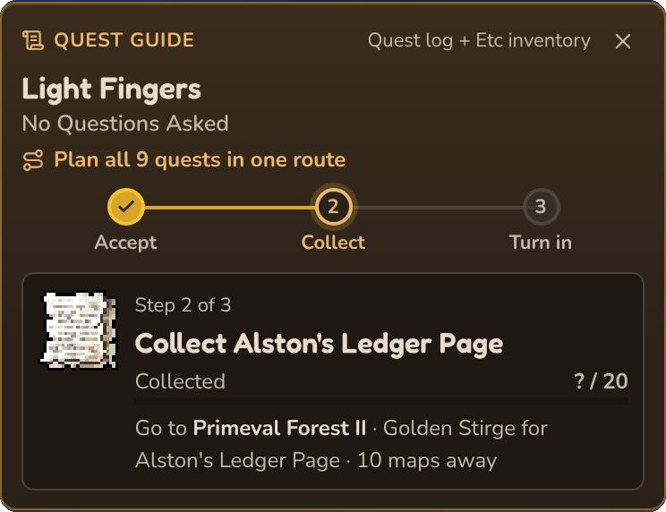
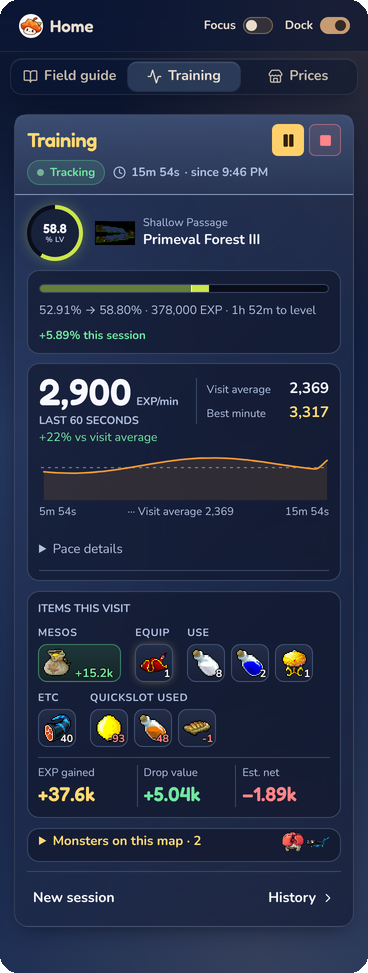
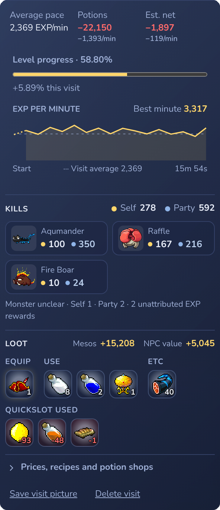

# MaplePal Field Guide

**A glass companion window that docks beside MapleStory.** 
Look anything up, get directions from where you stand, follow your quests and see what your training is really earning, without alt-tabbing to a wiki.

🔒 **Every download ships a SHA-256 checksum and a signed GitHub build attestation** you can verify, and a separate window that never touches the game. <a href="#is-it-safe">Is it safe? →</a>

🧪 **This is a beta.** The Field Guide is new and changes often, so some things may not work yet or may break after a game patch. If something looks off, <a href="https://github.com/gagandeepgill/maple-pal-public/issues/new/choose">let us know</a>. Every report helps.

  

## What it does

###  Field guide
Search one catalog of mobs, maps, quests, items, NPCs, recipes, skills, shops, furniture and appearances. Press <kbd>Ctrl</kbd> <kbd>K</kbd> to search, then open a record to see its stats, drops, spawn maps and where to find it. Everything is local, so results show up as you type.

###  Directions from where you stand
Pick a destination and the guide reads your minimap to find out where you are. It then draws the route on the real map art: which portal to take, when to climb, and when a taxi or town scroll is quicker.

###  Quest guide

Each quest is laid out as **Accept → Collect → Turn in**, with the map, the monster and how far away it is. The guide reads your quest log and Etc inventory to know which step you're on. **Plan all quests in one route** chains a whole questline into one trip.

 

###  Training tracker
Start tracking and the widget reads your EXP bar: EXP per minute, your best minute, time to next level, and how this visit compares with your average. It also counts mesos and drops, the potions you used and their cost, and your kills (yours and your party's), and shows your net profit. It can start by itself once you're hunting. Every visit is saved to **History** so you can compare maps.

&nbsp;&nbsp;

###  Prices
Hover over an item in MapleStory and its price shows up in the widget: the last sale, median sale and median asking price, recent sales by channel, and how the price moved this week. Prices come from Cozy Market and MesoWatch.

###  Made to sit beside the game
- **Dock** snaps it to the edge of the screen. **Focus** brings it forward when you return to the game, and MapleStory keeps your keyboard.
- **Open with MapleStory** starts the widget when the game comes to the front.
- It reads only what the game already shows on screen and its installed files. It never changes the game or its files.

## Install

1. **[Download `MaplePal-Field-Guide-setup.exe`](https://github.com/gagandeepgill/maple-pal-public/releases/latest/download/MaplePal-Field-Guide-setup.exe)** and run it. It installs for your Windows user only, with no admin prompt, and adds a Start menu entry.
2. If Windows says **"Windows protected your PC"**, click **More info**, then **Run anyway**. This shows up because the installer isn't code-signed yet.
3. Open **MaplePal Field Guide** from the Start menu. On the first start, click **Import from another PC** to load a data pack, or **Download catalog**.
4. If MapleStory isn't installed in `C:\Nexon\Library\maplestorycw`, open **Window settings → Open with MapleStory → Change** and choose its `MapleStory.exe`.

**Requirements:** 64-bit Windows 11, or Windows 10 version 2004 or later. If the PC doesn't have Microsoft Edge WebView2, the installer downloads it.

## Is it safe?

<table>
<tr><th>✅ What it does</th><th>🚫 What it never does</th></tr>
<tr><td valign="top">

- Captures the MapleStory window, the way OBS or a screenshot tool does, to read the minimap, EXP bar and the item you hover over
- Reads the game's installed files for maps, quests and items
- Connects to GitHub for updates, and to Cozy Market and MesoWatch for prices
- Saves its data in your own user folder

</td><td valign="top">

- Draw on top of the game or hook into it — it's a separate window you dock beside MapleStory, **not an overlay**
- Read or change the game's memory, or inject anything into the game
- Press keys or click for you (no botting or macros)
- Ask for your Nexon or MapleStory login
- Send your quests, Training history or settings anywhere

</td></tr>
</table>

**Check the download yourself**

- **Scan it:** upload the installer to [VirusTotal](https://www.virustotal.com), which runs it past about 70 antivirus engines. When a release's notes include a VirusTotal link, that scan was made by the same workflow that built the file.
- **Compare the checksum:** each release lists the installer's SHA-256 in its notes and in `SHA256SUMS.txt`. In PowerShell, run `Get-FileHash .\MaplePal-Field-Guide-setup.exe`. The hash should match exactly.
- **See where it was built:** every installer is built by this repository's public [Actions workflow](.github/workflows/release.yml), and the [build logs](https://github.com/gagandeepgill/maple-pal-public/actions) are public. Each build has a signed GitHub attestation. With the GitHub CLI, `gh attestation verify MaplePal-Field-Guide-setup.exe --repo gagandeepgill/maple-pal-public` confirms the file came from that workflow and wasn't changed after.
- **Updates are signed:** the widget installs an update only if it carries the release signature, so a tampered download is refused.

**Why does Windows warn about it?** SmartScreen shows "Windows protected your PC" for any new app that hasn't been code-signed and downloaded by many people yet. It isn't a virus detection. Click **More info**, then **Run anyway**.

## FAQ

<b>Something isn't working. How do I report it?</b>

Thanks for trying the beta! [Open a report](https://github.com/gagandeepgill/maple-pal-public/issues/new/choose) and say what you were doing, what you expected and what happened instead. Add the version from the bottom of the widget and a screenshot if you can. Please don't include your Nexon login or anything else private.

<b>How does it update?</b>

It checks for a new version every 30 minutes and downloads it in the background. The update installs when you click **Restart to update**, when you close the widget, or after 10 idle minutes when nothing is being tracked. A small progress bar shows for about 20 seconds. Every update is checked against a signature before it installs.

<b>Is my data uploaded anywhere?</b>

No. Your quest progress, Training history and settings stay on your PC in `%LOCALAPPDATA%\MaplePal\FieldGuide`. Updates and reinstalls never touch them. This repository holds only the installer and its update files. It has no source code and no player data.

<b>Does it work for any character or server?</b>

Yes. Nothing is tied to one character or account. Quest and Training progress builds up from whichever character you're playing on that PC.

<b>Does it work on Mac?</b>

Not directly. It's a Windows app, so on a Mac it needs a Windows virtual machine that can also run MapleStory.

<b>The Training tracker or Prices show nothing.</b>

Keep the MapleStory window visible, not minimised, with the EXP bar showing. Training reads the HUD, and Prices reads the item you're hovering over.

<b>How do I uninstall it?</b>

First turn off **Open with MapleStory** so its sign-in watcher is removed too. Then uninstall **MaplePal Field Guide** from **Settings → Apps**. Your data stays unless you tick **Delete the application data**.

---

MaplePal Field Guide is a fan-made tool and is not affiliated with or endorsed by Nexon. MapleStory is a trademark of Nexon.
